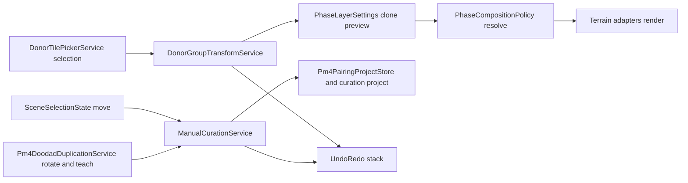

# Plan: Spatial Donor Transforms and Manual PM4 Curation (Spec 294)

**Status:** Operator-approved 2026-11-05; implementation Phases 1–4 are complete. Phase 5/final operator proof gates remain.
**Spec:** [`spec.md`](spec.md) (FR-001…FR-012, SC-001…SC-004).
**Quality gate:** [`checklists/requirements.md`](checklists/requirements.md) passes; clarifications for FR-007/FR-009/FR-011 resolved 2026-11-05.

## 1. What exists today (verified in tree)

| Capability | Current state | Evidence |
|---|---|---|
| Multi-tile donor selection | [`DonorTilePickerService`](wow-viewer/src/viewer/WoWViewer/Workbench/Services/Archaeology/DonorTilePickerService.cs:28) holds a multi-select set and creates one layer from it | [`DonorTilePickerService.cs`](wow-viewer/src/viewer/WoWViewer/Workbench/Services/Archaeology/DonorTilePickerService.cs:445) |
| Whole-layer rotation model | [`PhaseLayerSettings.RotationDegrees`](wow-viewer/src/core/WowViewer.Core/Maps/PhaseComposition.cs:94) is a free float with pivot [`RotationOriginTileX`](wow-viewer/src/core/WowViewer.Core/Maps/PhaseComposition.cs:98); non-quarter-turns use grid-snapped tile lookup with exact placement points | [`PhaseComposition.cs`](wow-viewer/src/core/WowViewer.Core/Maps/PhaseComposition.cs:88) |
| Quarter-turn UI | Layer panel exposes only a 4-choice combo; custom values render as a label but cannot be entered | [`ArchaeologyPanelService.PhaseLayers.cs`](wow-viewer/src/viewer/WoWViewer/Workbench/Services/Archaeology/ArchaeologyPanelService.PhaseLayers.cs:571) |
| Layer persistence | [`PhaseLayerProjectFile`](wow-viewer/src/core/WowViewer.Core/Maps/PhaseLayerProjectFile.cs:11) already round-trips [`RotationDegrees`](wow-viewer/src/core/WowViewer.Core/Maps/PhaseLayerProjectFile.cs:70) and per-tile placements | [`PhaseLayerProjectFile.cs`](wow-viewer/src/core/WowViewer.Core/Maps/PhaseLayerProjectFile.cs:93) |
| Object move | [`SceneSelectionState.MovePlacementInstance`](wow-viewer/src/viewer/WoWViewer/Terrain/Scene/Selection/SceneSelectionState.cs:467) repositions a selected placement | [`SceneSelectionState.cs`](wow-viewer/src/viewer/WoWViewer/Terrain/Scene/Selection/SceneSelectionState.cs:199) |
| Object rotate | [`Pm4DoodadDuplicationService.RotatePlacement`](wow-viewer/src/viewer/WoWViewer/Workbench/Services/Pm4Workbench/Pm4DoodadDuplicationService.cs:780) applies yaw deltas; sidebar exposes only ±90° buttons | [`Pm4WorkbenchSidebarService.cs`](wow-viewer/src/viewer/WoWViewer/Terrain/Pm4/UI/Pm4WorkbenchSidebarService.cs:459) |
| Taught pairings | [`Pm4PairingProjectStore`](wow-viewer/src/viewer/WoWViewer/Terrain/Pm4/Pm4PairingProjectStore.cs:15) persists per-map taught pairings; [`TeachPairing`](wow-viewer/src/viewer/WoWViewer/Workbench/Services/Pm4Workbench/Pm4DoodadDuplicationService.cs:941) creates rules | [`Pm4PairingProjectStore.cs`](wow-viewer/src/viewer/WoWViewer/Terrain/Pm4/Pm4PairingProjectStore.cs:38) |
| Tests | [`PhaseTileSourceTests`](wow-viewer/tests/WowViewer.Core.Tests/Maps/PhaseTileSourceTests.cs:287) already cover free-rotate approximation; [`PhaseLayerProjectFileTests`](wow-viewer/tests/WowViewer.Core.Tests/Maps/PhaseLayerProjectFileTests.cs:25) cover rotation round-trip | [`PhaseTileSourceTests.cs`](wow-viewer/tests/WowViewer.Core.Tests/Maps/PhaseTileSourceTests.cs:287) |

**Gap summary:** the core rotation math and persistence already exist for whole layers. Spec 294 adds (a) group-as-one manipulation with preview/undo/redo, (b) arbitrary-angle entry in the UI, and (c) explicit manual object↔hull curation with duplicate protection. No terrain resampling or source-map writes (FR-007, FR-011).

## 2. Architecture

- **New owned service, UI-free core:** `DonorGroupTransformService` in `WowViewer.Core.Maps` owns group math (pivot, angle normalization, translation, relative-arrangement preservation, bounds/collision validation). It operates on [`PhaseTilePlacement`](wow-viewer/src/core/WowViewer.Core/Maps/PhaseComposition.cs:772) lists and returns a preview result; it never touches ImGui or the scene. Rotation maps tile-grid points through a rigid transform and snaps resulting tile indices to the nearest integer using midpoint-away-from-zero; collision/bounds validation runs after snapping. The preview carries the exact normalized angle and pivot separately from the snapped tile mappings, so later persistence can retain the authored transform without resampling terrain.
- **Preview/accept/cancel:** the service clones the layer via [`PhaseLayerSettings.Clone`](wow-viewer/src/core/WowViewer.Core/Maps/PhaseComposition.cs:198), applies the candidate transform to the clone, and the UI renders the clone. Accept commits the clone; cancel discards it. Source donor data is never mutated (FR-007).
- **Undo/redo:** a small snapshot stack of [`PhaseLayerSettings`](wow-viewer/src/core/WowViewer.Core/Maps/PhaseComposition.cs:75) clones (and, for curation, of manual placement + association lists). Each accepted transform/pair action pushes one entry; undo/redo restore snapshots. No new members in `WorldScene` or `ViewerApp` (AGENTS.md §10).
- **Manual curation service:** `ManualCurationService` (viewer layer, owned class) wraps existing move/rotate/teach primitives, adds explicit pair creation with an identity key (object instance + hull key), duplicate detection, and explicit remove/replace actions (FR-010, FR-012). Catalog placement creation reuses the existing asset-catalog spawn path; it does not invent a new catalog.
- **Persistence:** group transforms persist through the existing [`PhaseLayerProjectFile`](wow-viewer/src/core/WowViewer.Core/Maps/PhaseLayerProjectFile.cs:11) (extend only if a group identity field is needed, with a version bump and backward-compatible load). Manual placements and hull associations persist in the curation project store beside [`Pm4PairingProjectStore`](wow-viewer/src/viewer/WoWViewer/Terrain/Pm4/Pm4PairingProjectStore.cs:15); saving never writes source map files (FR-011).
- **UI:** all new controls use `SharedUiWidgets`, register in `ui-controls.json`, and pass `Verify-UiReference.ps1` (AGENTS.md §11). The quarter-turn combo stays (FR-006); an arbitrary-angle numeric input sits beside it.

## 3. Phases

### Phase 1 — Donor group transform core (FR-001, FR-002, FR-003, FR-007)
Pure core service + unit tests. No UI. Validatable by `dotnet test` on the Core test project.

### Phase 2 — Group transform UI with preview and undo/redo (FR-004, FR-005, FR-006)
Picker group mode, angle input, pivot readout, preview overlay, accept/cancel, undo/redo buttons. Build + UI-reference verification; runtime proof operator-owned.

### Phase 3 — Manual object placement and hull pairing (FR-008, FR-009, FR-010, FR-012)
Owned curation service, sidebar workbench section, duplicate guard, explicit remove/replace. Build + focused tests; runtime proof operator-owned.

### Phase 4 — Persistence and round-trip (FR-011, SC-002, SC-004)
Project-file extensions, save/reopen round-trip tests, source-file-unchanged guard test.

### Phase 5 — Receipts and operator proof gates (SC-001…SC-004)
§9.2 receipts per phase; operator runtime/visual gates recorded, never inferred from build/tests.

## 4. Edge cases handled by design

- Group spanning map edge or containing gaps: validation reports out-of-bounds members and blocks accept until resolved.
- Target collisions (two donors claiming one target): validation lists collisions; accept requires explicit resolution.
- Angle normalization: any finite degree value (negative, >360, fractional) normalizes to a canonical range; zero is a no-op preview.
- Single-tile group and off-group pivot: pivot defaults to group centroid; single-tile groups still transform.
- Cancel/undo/redo/reload mid-operation: preview lives on a clone, so cancel and reload are always safe.
- Already-paired object or shared hull: duplicate guard reports the existing relation; replacement is an explicit action.
- Save target that would require rewriting source maps: refused by design; curation state only.

## 5. Out of scope

- Terrain resampling/materialization for arbitrary angles (FR-007).
- Writing curated placements into source map files (FR-011).
- New PM4 decoding, new matchers, or automatic pairing (spec assumptions).
- Changes to protected format readers or `AlphaWdtWriter`.
- Any file growing past ~2,000 lines; any new `WorldScene`/`ViewerApp` members (AGENTS.md §10).

## 6. Verification strategy

- Core math: unit tests in `WowViewer.Core.Tests` (group preservation, angle normalization, bounds/collision, clone isolation).
- Persistence: round-trip tests in `PhaseLayerProjectFileTests` style; source-file hash guard.
- UI: solution build + `Verify-UiReference.ps1`; visual/runtime proof is operator-owned and recorded as owed gates.
- Every checked task carries a §9.2 receipt (files, commands + exits, criterion→real-output evidence).
