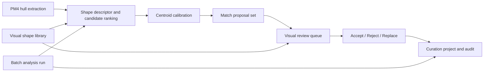

# Plan: Visual PM4 Shape Library and Human-in-the-Loop Pairing (Spec 295)

**Status:** Draft 2026-11-05. Planning only; no implementation started.
**Spec:** [`spec.md`](spec.md) (FR-001…FR-018, SC-001…SC-006).
**Quality gate:** [`checklists/requirements.md`](checklists/requirements.md) passes.

## 1. Operator intent check

The operator's words are the contract:

- The current shape library "matches to all the wrong centroids" and is "off by a hair" along **-X**.
- The tool must be "smarter": identify and pair automatically, but the human decides whether the object is right or replaces it with another possible match.
- The library must be **visual**, not text.

This plan therefore treats the -X offset as a measurable calibration defect, not a cosmetic tweak, and makes the operator's accept/reject/replace decision the only commit gate. Automatic analysis is advisory.

## 2. What exists today (verified in tree)

| Capability | Current state | Evidence |
|---|---|---|
| Shape-library matching | `Pm4UnauthoredPlacementResolver` ranks assets by `ShapeDistance` against a `Dictionary<string, List<Vector3>>` shape library and accepts at `<= 0.18` | [`Pm4UnauthoredPlacementResolver.cs`](../../src/core/WowViewer.Core.PM4/Matching/Pm4UnauthoredPlacementResolver.cs:411) |
| Placement attraction | `AttractPositionToPm4Mesh` subtracts a rotated model center from the PM4 centroid; this is the likely source of the -X bias | [`Pm4UnauthoredPlacementResolver.cs`](../../src/core/WowViewer.Core.PM4/Matching/Pm4UnauthoredPlacementResolver.cs:983) |
| Direct model matching | `Pm4DirectModelMatcher` scores bounds-derived descriptors and solves position from `prism.Centroid + rotatedOriginOffset` | [`Pm4DirectModelMatcher.cs`](../../src/core/WowViewer.Core.PM4/Matching/Pm4DirectModelMatcher.cs:64) |
| Footprint prism | `Pm4FootprintExtruder` already computes an oriented footprint center and yaw | [`Pm4FootprintExtruder.cs`](../../src/core/WowViewer.Core.PM4/Footprint/Pm4FootprintExtruder.cs:269) |
| PM4 workbench UI | `Pm4WorkbenchSidebarService` exposes overlay settings, selected-hull facts, nearby-model pairing, and align actions | [`Pm4WorkbenchSidebarService.cs`](../../src/viewer/WoWViewer/Terrain/Pm4/UI/Pm4WorkbenchSidebarService.cs:47) |
| Manual curation | `ManualCurationWorkbenchService` records placements and explicit hull associations in a curation-only project | [`ManualCurationWorkbenchService.cs`](../../src/viewer/WoWViewer/Workbench/Services/WorkbenchPanels/ManualCurationWorkbenchService.cs:21) |
| Persistence | `Pm4PairingProjectStore` and the curation project already persist per-map pairings | [`Pm4PairingProjectStore.cs`](../../src/viewer/WoWViewer/Terrain/Pm4/Pm4PairingProjectStore.cs:15) |
| Tests | `Pm4DirectModelMatcher` and `Pm4FootprintExtruder` have focused coverage; no visual-library or review-queue tests exist | `wow-viewer/tests/WowViewer.Core.Tests` |

**Gap summary:** the matcher is a text-keyed shape dictionary with a single distance threshold and no review surface. The -X bias is unmeasured and uncalibrated. There is no visual catalog, no ranked candidate list, no accept/reject/replace state, and no batch audit.

## 3. Architecture

- **Core, UI-free analysis:** a new `Pm4ShapeMatchAnalysisService` in `WowViewer.Core.PM4` owns candidate generation, ranking, confidence, and the calibration value. It consumes existing hull groups, footprint prisms, and model descriptors; it does not touch ImGui or the scene.
- **Calibration first:** a `Pm4CentroidCalibration` value (signed X/Y/Z offset plus a source note) is measured from authored ground truth on a validation tile. The analysis service applies it once, at the proposal boundary, and exposes it for inspection/reset. The existing `AttractPositionToPm4Mesh` math is not silently changed; the calibration is a separate, visible correction so the operator can see and reset it.
- **Visual library:** a `Pm4ShapeLibraryVisualService` in the viewer layer builds a catalog from the existing shape library and model catalog. Each entry carries a preview (rendered model thumbnail or footprint silhouette), proportions, asset paths, and a health flag for missing assets. The catalog is the single source for the review queue's "replace" choices.
- **Review queue:** a `Pm4ShapeMatchReviewService` in the viewer layer owns the proposal list, current index, accept/reject/replace actions, and audit history. It writes decisions through the existing curation project; it does not invent a second persistence store.
- **Batch analysis:** a `Pm4ShapeMatchBatchService` runs the core analysis over a map or tile range, reports progress, supports cancellation, and preserves accepted decisions. It is a coordinator, not a new matcher.
- **UI:** the PM4 workbench gains a visual library panel and a review panel. All controls use `SharedUiWidgets`, register in `ui-controls.json`, and pass `Verify-UiReference.ps1` (AGENTS.md §11). No new members in `WorldScene` or `ViewerApp` (AGENTS.md §10); the work lives in owned services.

## 4. Phases

### Phase 0 — Measure the -X offset and define the calibration contract (FR-005, SC-001)
- Build a measurement harness over a validation tile with known authored objects.
- Record the signed offset between the proposed model footprint center and the hull footprint center.
- Define `Pm4CentroidCalibration` (fields, sign convention, reset, provenance) and unit tests for apply/reset.
- Gate: the measured offset is reproducible and the calibration contract is documented before any matcher change.

### Phase 1 — Core candidate ranking and proposal model (FR-004, FR-006, FR-012, FR-015)
- Add `Pm4ShapeMatchAnalysisService` with ranked candidates, confidence, and unmatched/low-confidence classification.
- Add conflict detection for multiple hulls claiming one object.
- Unit tests for ranking, threshold behavior, conflict detection, and degenerate hulls.
- Gate: focused tests pass; no UI yet.

### Phase 2 — Visual shape library (FR-001, FR-002, FR-003, FR-016)
- Add `Pm4ShapeLibraryVisualService` and the visual catalog panel.
- Render previews from existing model assets; mark missing/unreadable assets.
- Add search, filter, compare, and selection retention.
- Gate: build + UI reference check; operator visual proof owed.

### Phase 3 — Review queue and human decisions (FR-007, FR-008, FR-009, FR-010, FR-011, FR-018)
- Add `Pm4ShapeMatchReviewService` and the review panel.
- Accept, reject, replace from the visual library; preview in the 3D view before commit.
- Persist decisions and audit history through the curation project.
- Gate: save/reopen round-trip tests; operator review proof owed.

### Phase 4 — Batch analysis and audit export (FR-013, FR-014, FR-017)
- Add `Pm4ShapeMatchBatchService` with progress, cancellation, and summary counts.
- Export the analysis summary with hull, proposal, score, and decision provenance.
- Gate: cancellation preserves accepted decisions; summary counts reconcile.

### Phase 5 — Receipts and operator proof gates (SC-001…SC-006)
- §9.2 receipts per phase; operator runtime/visual gates recorded, never inferred from build/tests.

## 5. Edge cases handled by design

- Multiple visually identical candidates: the review queue shows the ranked list and the visual library allows comparison before replacement.
- Rotated/mirrored hull: the preview applies the same transform used by the proposal, so the operator sees the actual alignment.
- Missing asset: the library entry is marked unhealthy and excluded from automatic proposals; the review queue shows a placeholder.
- Degenerate hull: reported as unmatched, never forced into a shape.
- Duplicate claim: conflict is surfaced before accept; the operator resolves it explicitly.
- Calibration applied twice or with the wrong sign: the calibration is a single visible value with a reset; tests cover idempotence and sign.
- Cancelled batch: accepted decisions remain; only pending proposals are discarded.
- Stale library entries: excluded from automatic proposals and flagged in the catalog.

## 6. Out of scope

- New PM4 decoding or new geometry extraction beyond the existing hull/prism pipeline.
- Automatic commit without operator acceptance (except an explicitly enabled, bounded auto-accept mode).
- Rewriting source map files; decisions remain curation-only.
- Changes to protected format readers or `AlphaWdtWriter`.
- Any file growing past ~2,000 lines; any new `WorldScene`/`ViewerApp` members (AGENTS.md §10).

## 7. Verification strategy

- Core: unit tests in `WowViewer.Core.Tests` for ranking, calibration, conflict detection, and degenerate hulls.
- Persistence: save/reopen round-trip tests for decisions and audit history.
- UI: solution build + `Verify-UiReference.ps1`; visual/runtime proof is operator-owned and recorded as owed gates.
- Calibration: a measured validation-tile report with the signed offset and the post-calibration residual.
- Every checked task carries a §9.2 receipt (files, commands + exits, criterion→real-output evidence).
