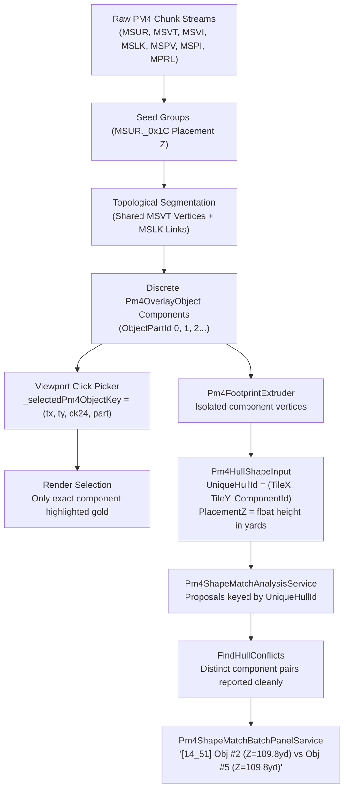

# Plan 296 — PM4 Object Identity, Topological Segmentation & Conflict Decoupling

## 1. Architectural Strategy

We transition PM4 tooling from flat `uint Ck24` keys to a structured composite object identity (`Pm4ObjectIdentity`) and 64-bit unique hull keys (`ulong UniqueHullId`).

---

## 2. File Change Roadmap

1. **`wow-viewer/src/core/WowViewer.Core.PM4/Matching/Pm4ShapeMatchModels.cs`**:
   - Add `Pm4ObjectIdentity` struct.
   - Add `ulong UniqueHullId` helper on `Pm4HullShapeInput`: `MakeUniqueHullId(int tileX, int tileY, int componentId)`.
   - Update `Pm4ShapeMatchProposal` to carry `ulong UniqueHullId` alongside legacy `HullKey` for backwards compatibility.
   - Add formatted identity helper methods: `GetDisplayLabel()`.

2. **`wow-viewer/src/core/WowViewer.Core.PM4/Matching/Pm4ShapeMatchAnalysisService.cs`**:
   - Update `Analyze` to assign `HullKey = (uint)hull.ObjectPartId` (or hash of `UniqueHullId`) so distinct parts never share the same key.
   - Update `FindHullConflicts` to compare `hullA.ObjectPartId != hullB.ObjectPartId` when on the same tile.

3. **`wow-viewer/src/viewer/WoWViewer/Workbench/Services/Pm4Workbench/Pm4ShapeMatchBatchPanelService.cs`**:
   - Update conflict formatting string to display:
     `Obj #{conflict.FirstHull.ObjectPartId} (Z={conflict.FirstHull.Descriptor.PrismCentroid.Z:F1}yd) vs Obj #{conflict.SecondHull.ObjectPartId} claiming {Path.GetFileName(conflict.ModelPath)} ({conflict.DistanceBetweenHulls:F1} yds apart)`.

4. **`wow-viewer/src/viewer/WoWViewer/Workbench/Services/Pm4Workbench/Pm4ShapeMatchBatchService.cs`**:
   - Update summary rows and JSON/Markdown export templates to include `ComponentId`, `LinkGroupObjectId`, and `PlacementZ (yd)`.

5. **`wow-viewer/tests/WowViewer.Core.Tests/PM4/Pm4ObjectIdentityTests.cs`**:
   - New unit test suite verifying `Pm4ObjectIdentity`, unique hull ID calculation, conflict disambiguation between parts at the same $Z$, and batch summary export formatting.

---

## 3. Verification & Gating

- **Compilation**: Full solution build with 0 errors via `dotnet build I:/parp/parp-tools/wow-viewer/WowViewer.slnx -c Debug`.
- **Focused Tests**: `dotnet test --filter "FullyQualifiedName~Pm4ShapeMatch|FullyQualifiedName~Pm4ObjectIdentity"`.
- **UI Inventory**: `pwsh -File wow-viewer/eng/ui/Verify-UiReference.ps1` (0 errors, 0 warnings).

