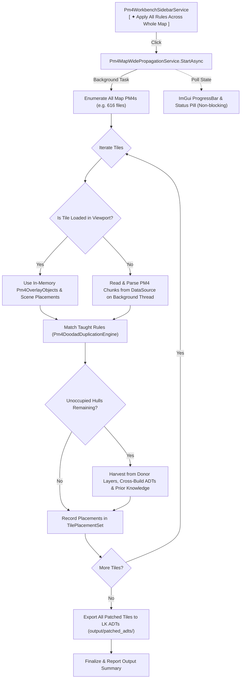

# Technical Plan — Spec 299: All-Tile PM4 Rule Propagation & LK ADT Export

## 1. Architectural Strategy & Design

To respect AGENTS.md §10 (God-Class Freeze: `Pm4DoodadDuplicationService.cs` is already at 2,289 lines), we create a standalone service:
`wow-viewer/src/viewer/WoWViewer/Workbench/Services/Pm4Workbench/Pm4MapWidePropagationService.cs`.

This service owns:
1. **Background Task Lifecycle**: `IsRunning`, `CancellationTokenSource`, `StartAsync()`, `Cancel()`.
2. **Progress Telemetry**: `ProcessedTiles`, `TotalTiles`, `CurrentTileName`, `Phase`, `PlacementsAdded`, `TilesExported`, `ExportDirectory`, `ErrorMessage`.
3. **Map-Wide PM4 Tile Enumerator**: Enumerates all PM4 candidate paths for the loaded map from `_dataSource.GetFileList(".pm4")`.
4. **On-Demand Unloaded Tile Parsing**: Reads and parses PM4 chunks (`Pm4File.Read`) for unopened tiles, converting them to collision hull candidates with world transforms matching `Pm4OverlayGeometry`.
5. **Donor & Missing Data Resolution**: Scans donor layer placements (`worldScene.Layers`), donor ADTs, and `Pm4PriorKnowledgeDatabase` / `Pm4UnauthoredPlacementResolver` to match unoccupied hulls that lack human-taught rules.
6. **LK ADT Export Engine**: Upon propagation completion, streams each modified tile through `AdtPlacementEditor` (for tiles with base ADTs) or `BlankAdtFactory` + `LkAdtWriter` (for blank unauthored tiles), writing `.adt` files to `output/patched_adts/<mapName>/`.

## 2. File Changes

1. **`wow-viewer/src/viewer/WoWViewer/Workbench/Services/Pm4Workbench/Pm4MapWidePropagationService.cs`** (New File):
   - Implements `Pm4MapWidePropagationService` with `RunPropagationAndExportAsync`.
   - Dispatches background thread, updates atomic/volatile progress properties.
   - Executes pairing propagation, donor harvest fallback, and LK ADT export.
2. **`wow-viewer/src/viewer/WoWViewer/Terrain/Pm4/UI/Pm4WorkbenchSidebarService.cs`**:
   - Replaces synchronous `ApplyAllTaughtPairingsAcrossAllTiles()` button with interactive status / progress bar when `_propagationService.IsRunning`.
   - Renders progress bar, current tile indicator, placement counter, and `[ Cancel ]` button.
3. **`wow-viewer/src/viewer/WoWViewer/ViewerApp.cs` (or DI / Service registration)**:
   - Exposes `Pm4MapWidePropagationService` via `IViewerAppHost` / workbench context.
4. **`wow-viewer/tests/WowViewer.Core.Tests/PM4/Pm4MapWidePropagationTests.cs`** (New File):
   - Unit tests verifying map-wide PM4 tile discovery, rule matching across unopened mock tiles, and progress calculation.

## 3. Implementation Phases

- **Phase 1**: Map-wide PM4 discovery and on-the-fly unloaded tile hull parser.
- **Phase 2**: Background runner architecture with thread-safe progress telemetry and cancellation.
- **Phase 3**: Cross-build / donor harvest and prior knowledge fallback for unoccupied missing hulls.
- **Phase 4**: Automated LK ADT export pipeline invoking `LkAdtWriter` / `AdtPlacementEditor`.
- **Phase 5**: UI progress bar, control registration in `ui-controls.json`, and verification receipt.
