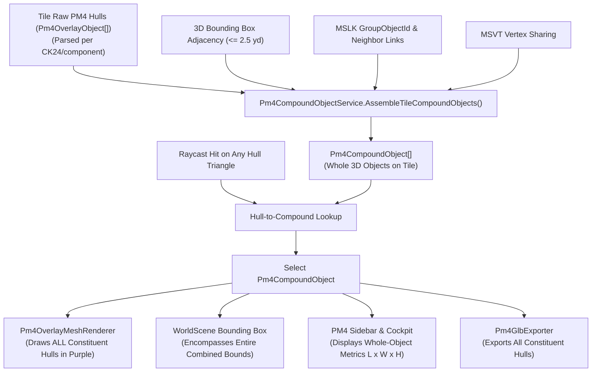

# Plan 300 — PM4 Whole-Object Assembly, Compound Hull Selection & Unified Spatial Matching

## 1. Architectural Strategy & Decomposition

To adhere strictly to AGENTS.md §4 (maintain core/viewer separation) and §10 (god-class freeze: no new members in `WorldScene` or `ViewerApp`), all compound assembly and tracking logic will be cleanly encapsulated within dedicated service classes:
- Model: `Pm4CompoundObject.cs` in `WoWViewer.Terrain.Pm4`.
- Service: `Pm4CompoundObjectService.cs` in `WoWViewer.Terrain.Pm4`.

`Pm4OverlayScene` maintains a mapping of `(tileX, tileY)` to `List<Pm4CompoundObject>`, a reverse map from `(tileX, tileY, ck24, objectPart)` to `Pm4CompoundObject`, and an optional `_selectedCompoundObject`.

---

## 2. File Changes

### Viewer Subsystem (`WoWViewer`)
1. `wow-viewer/src/viewer/WoWViewer/Terrain/Pm4/Models/Pm4CompoundObject.cs` (New):
   - Record `Pm4CompoundObject` with aggregate dimensions, bounds, constituent hulls, and centroid.
2. `wow-viewer/src/viewer/WoWViewer/Terrain/Pm4/Services/Pm4CompoundObjectService.cs` (New):
   - Implements spatial proximity clustering, MSLK/MSVT topological connection clustering, and compound object assembly.
3. `wow-viewer/src/viewer/WoWViewer/Terrain/Pm4/Pm4OverlayScene.cs` & `Selection.cs`:
   - Store and maintain `_tileCompoundObjects` and `_hullToCompoundLookup`.
   - Update `SelectPm4ObjectByRay` and `ClearPm4Selection` to select and track the compound whole object.
   - Expose `SelectedCompoundObject` and `SelectedPm4Hulls`.
4. `wow-viewer/src/viewer/WoWViewer/Terrain/Pm4/Services/Pm4OverlayMeshRenderer.cs`:
   - Update wireframe renderer to check if an object's hull is in the selected compound object's constituent hulls.
5. `wow-viewer/src/viewer/WoWViewer/Terrain/WorldScene.cs`:
   - Update selection bounding box logic to wrap `selectedCompoundObject.WorldBoundsMin` to `WorldBoundsMax`.
6. `wow-viewer/src/viewer/WoWViewer/Terrain/Pm4/UI/Pm4WorkbenchSidebarService.cs`:
   - Render compound object details: title, dimensions, hull count, triangles, nearest model, and constituent hull inspector.
7. `wow-viewer/src/viewer/WoWViewer/Export/Pm4GlbExporter.cs`:
   - Support exporting all constituent hulls of a `Pm4CompoundObject`.

### Core Tests (`WowViewer.Core.PM4.Tests`)
8. `wow-viewer/tests/WowViewer.Core.PM4.Tests/Pm4CompoundObjectTests.cs` (New):
   - Unit tests covering spatial AABB overlap clustering, multi-hull compound metrics calculation, and bounds aggregation.

---

## 3. Phase Roadmap

- **Phase 1: Compound Model & Assembly Engine**: Author `Pm4CompoundObject` and `Pm4CompoundObjectService`.
- **Phase 2: Scene & Raycast Selection Integration**: Integrate compound assembly into `Pm4OverlayScene`, wire raycast hit resolution to compound object selection.
- **Phase 3: Viewport Rendering & Bounding Box**: Render all constituent hulls in selection wireframe and render the combined bounding box in `WorldScene`.
- **Phase 4: Cockpit UI & GLB Export**: Update tooltip, sidebar card, and GLB export actions for whole objects.
- **Phase 5: Verification & Governance**: Solution build, unit tests, UI reference check, and verification receipt.
