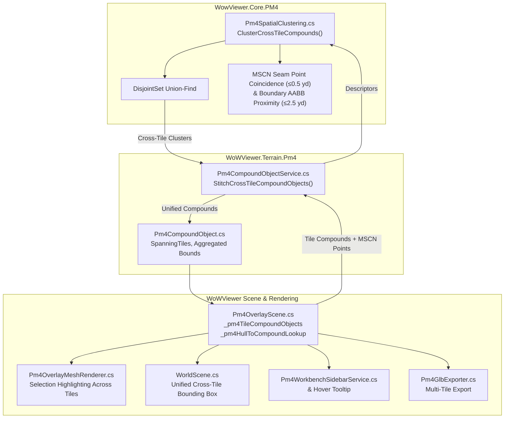

# Spec 301 Plan: PM4 Cross-Tile MSCN Compound Stitching & Multi-Tile Selection

## Architecture & Data Flow

## Implementation Phases

### Phase 1: Core Cross-Tile Clustering Engine (`WowViewer.Core.PM4`)
- Create `Pm4CrossTileCompoundDescriptor` defining:
  - `CompoundId`, `TileX`, `TileY`
  - `BoundsMin`, `BoundsMax`
  - `MscnPoints` (world coordinates)
  - `ConnectorKeys` (quantized keys)
- Implement `ClusterCrossTileCompounds` in `Pm4SpatialClustering.cs`:
  - Evaluate pairwise adjacent tiles ($|\Delta X| \le 1, |\Delta Y| \le 1$).
  - Merge candidates if:
    a) Seam MSCN coincidence ($\le 0.5\,\text{yd}$ between MSCN world points near tile border, or shared `ConnectorKey`).
    b) Boundary AABB overlap within $2.5\,\text{yd}$ along shared border with seam MSCN proximity.

### Phase 2: Multi-Tile Compound Object Model (`WoWViewer.Terrain.Pm4`)
- Extend `Pm4CompoundObject.cs` constructor to accept compound clusters from multiple tiles.
- Store `IReadOnlySet<(int TileX, int TileY)> SpanningTiles` and `IsCrossTile`.
- Aggregate world bounds, centroid, dimensions, and totals across all constituent hulls.
- Update `DisplayName` to display spanning tiles e.g. `[13_50 + 13_51] Cross-Tile Whole Obj #0`.

### Phase 3: Stitching Service & Scene Lifecycle (`WoWViewer.Terrain.Pm4`)
- Implement `StitchCrossTileCompoundObjects` in `Pm4CompoundObjectService.cs`.
- In `Pm4OverlayScene.cs`, after tile loading (in `MergePm4OverlayFromCache` and `LoadSinglePm4OverlayFileDirect`):
  - Ensure MSCN points exist for loaded tiles (`EnsurePm4MscnData()`).
  - Run `StitchCrossTileCompoundObjects` to combine boundary-crossing compound objects.
  - Re-map `_pm4HullToCompoundLookup` to the stitched compound instances.
  - Preserve any active selection across stitch updates.

### Phase 4: Viewport Rendering, Selection Box, Tooltips & GLB Export
- Verify `Pm4OverlayMeshRenderer.cs` highlights all constituent hulls across all spanning tiles.
- Verify `WorldScene.cs` renders the unified bounding box around `SelectedCompoundObject.WorldBoundsMin` to `WorldBoundsMax`.
- Update `SceneHoverAndPickService.cs` and `Pm4WorkbenchSidebarService.cs` to show multi-tile badge and hull list grouped by tile.
- Verify `ExportCompoundObjectGlb` exports all hulls from all spanning tiles.

### Phase 5: Verification & Governance
- Add unit tests in `Pm4SpatialClusteringTests.cs` verifying cross-tile MSCN stitching and border contact.
- Verify solution builds with 0 errors (`dotnet build WoWViewer.csproj -c Debug -m:1`).
- Verify unit tests pass 100%.
- Run UI reference check (`Verify-UiReference.ps1`).
- Write receipt in `evidence/receipt-spec301.md`.

